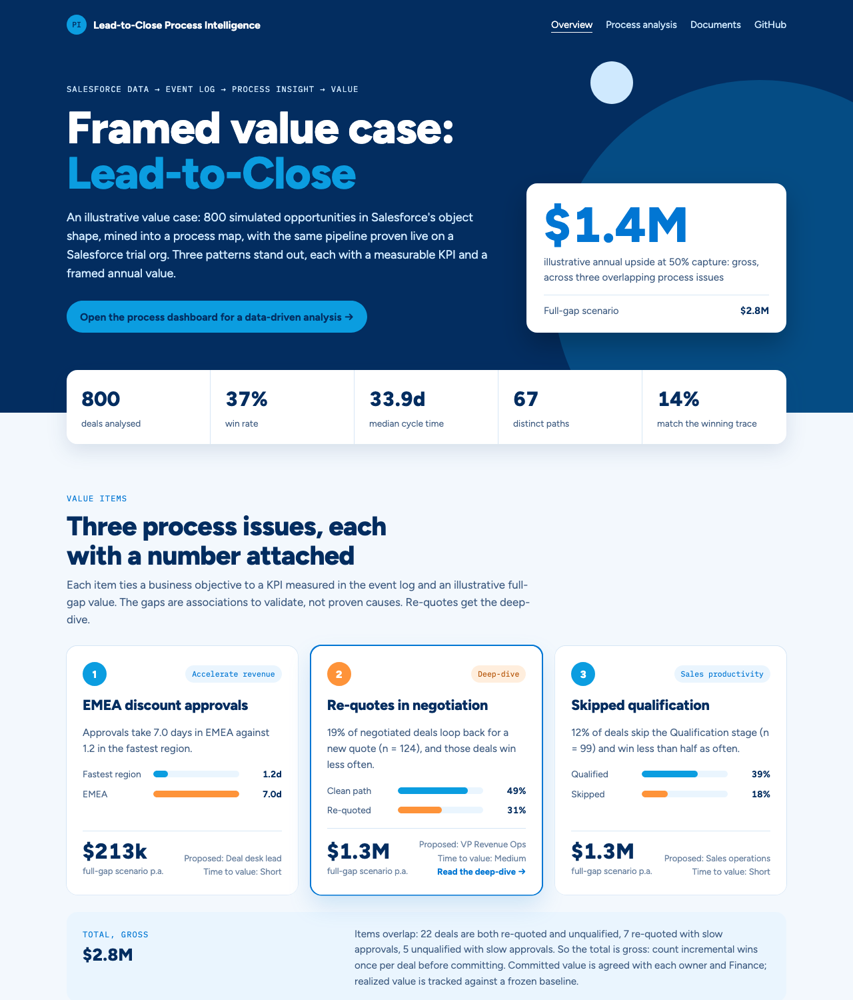
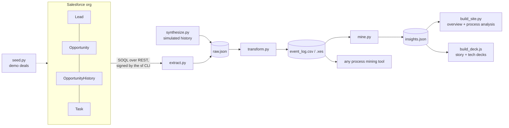
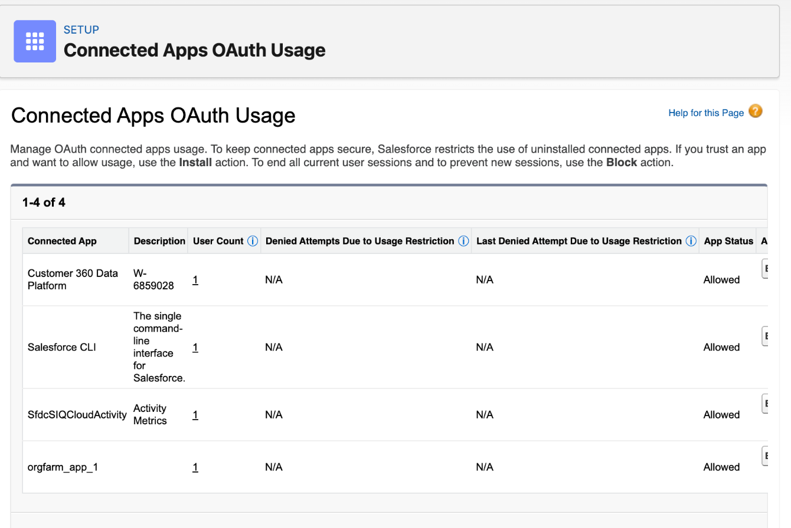

# Process Intelligence on Salesforce data

Takes lead-to-close data out of a Salesforce org, turns it into a process-mining event log (CSV and IEEE XES), mines it for bottlenecks and deviations, and frames the value of fixing them as a business case.

| | |
|---|---|
| **Overview** | https://salesforce-process-intelligence.vercel.app: value items, the re-quote business case, approach, data assets and documents |
| **Process analysis** | https://salesforce-process-intelligence.vercel.app/dashboard.html: interactive process map, paths, bottlenecks and value model |
| **Story deck** | [PDF](deck/salesforce-process-intelligence.pdf) · 8 slides: answer, evidence, value case, next steps |
| **Tech setup deck** | [PDF](deck/salesforce-process-intelligence-tech-setup.pdf) · 3 slides: from a Salesforce org to an event log |



> **About the data.** The business case is an *illustrative* scenario: 800 opportunities simulated in Salesforce's exact object shape, with process issues planted on purpose. The same pipeline runs unchanged against a real Salesforce trial org (40 seeded opportunities, 351 events in [`data/live/`](data/live/)), which proves the extraction, not the numbers. Value figures are gross, overlapping and based on associations that would need validating with the process owners and Finance.

## How it works



1. **Extract** (`pipeline/extract.py`): SOQL for Lead, Opportunity, OpportunityHistory and Task. Requests go through `sf api request rest`, so the Salesforce CLI session signs them and no credentials are stored.
2. **Correlate** (`pipeline/transform.py`): one case per Opportunity. Leads join on `ConvertedOpportunityId`, Tasks on `WhatId`, and repeated history rows collapse into real stage changes.
3. **Load**: an event log with case, activity, start/end, resource and case attributes, as CSV and as XES with start/complete lifecycle events.
4. **Mine and size** (`pipeline/mine.py`): directly-follows graph, variants, cohort win rates, overlaps between cohorts, and a driver-based value model.

Python uses only the standard library. The decks use Node (`pptxgenjs`).

## Quick start

Simulated data, no Salesforce needed:

```bash
python3 pipeline/synthesize.py && python3 pipeline/transform.py && python3 pipeline/mine.py && python3 pipeline/build_site.py
```

Open `site/index.html`, or serve `site/` with any static server.

A live Salesforce org (a free trial or Developer Edition):

```bash
sf org login web --alias trial --instance-url https://<your-domain>.my.salesforce.com
```

```bash
python3 pipeline/seed.py --target-org trial --deals 40
```

```bash
python3 pipeline/extract.py --target-org trial --out data/live/raw.json && PI_DATA=data/live python3 pipeline/transform.py && PI_DATA=data/live python3 pipeline/mine.py
```

`seed.py --cleanup` deletes everything it created (every seeded record is prefixed `[Demo]`).

The decks:

```bash
cd deck && npm ci && npm run build
```

## Data model

| Event log field | Salesforce source |
|---|---|
| Case ID | `Opportunity.Id` |
| `Lead Created` | `Lead.CreatedDate`, joined on `Lead.ConvertedOpportunityId` |
| Stage activities | `OpportunityHistory.StageName` and `CreatedDate`; repeated rows collapse to real stage changes |
| Task activities | `Task.Subject`, `CreatedDate` → `CompletedDateTime`, joined on `Task.WhatId` |
| Resource | `CreatedBy.Name` for stage changes, `Owner.Name` for tasks |
| Case attributes | `Opportunity.Amount`, `LeadSource`, `IsWon`, `Owner.Name`, `Account.Industry`, `Account.BillingCountry` (mapped to region) |

### Loading into a process mining tool

Import `data/event_log.csv` (or the `.xes`) and map the columns:

| Column | Role |
|---|---|
| `case_id` | Case ID |
| `activity` | Activity |
| `start_time` / `end_time` | Start / end timestamp (`yyyy-MM-dd HH:mm:ss`) |
| `resource` | Resource |
| `region`, `industry`, `lead_source`, `amount`, `discount_pct`, `outcome`, `owner` | Case attributes |
| `source_object` | Event attribute |

## Value model

```
annual value = deals in scope per year × win-rate gap (problem vs comparison cohort) × average won deal × share of the gap closed
```

- **Amount means bookings.** Figures are modelled incremental bookings. Finance would validate measured bookings, and revenue recognition is a separate question.
- **Like with like.** Re-quotes are compared only among deals that reached Negotiation/Review.
- **Gross, not net.** The three opportunities overlap (22, 7 and 5 deals, reported in `insights.json`), so each deal win has to be counted once before anything is committed.
- **Associations, not causes.** The win-rate gaps would be tested in a controlled pilot before any policy change.
- **Scenario.** The re-quote deep-dive (≈ $667k) assumes cutting re-quotes from 19.2% to 9.6% of negotiated deals and recovering the observed win-rate gap on those deals.

## Notes from setting up a new trial org

- **New orgs block uninstalled connected apps.** Allow the CLI under Setup → Connected Apps OAuth Usage → Salesforce CLI → Install.
- **Newer Starter orgs use a shorter sales process** (Qualify → Meet & Present → Propose → Negotiate). `seed.py` and `mine.py` detect it and map the stages.
- **The CLI redacts access tokens in its output**, so `sf_client.py` routes requests through `sf api request rest` instead of handling the token.
- **History can't be backdated in a trial org**, which is why the analysis uses the simulated dataset.



### Known limits

- Task `CreatedDate` → `CompletedDateTime` can include queueing time, not just work time.
- Open tasks have no completion time and show as zero duration.
- The CSV/XES export follows the standard column layout, but importing it into a specific tool hasn't been verified yet.
- A production version would add Bulk API 2.0 with incremental refresh, stable event IDs, approval history from `ProcessInstance`, and reconciliation against source counts.

## Repository layout

```
pipeline/            Python, standard library only
  sf_client.py       REST client; requests are signed by the Salesforce CLI session
  extract.py         SOQL extract -> raw.json
  seed.py            loads [Demo] deals into an org and walks them through stages
  synthesize.py      simulated history in the same shape as extract.py
  transform.py       raw.json -> event_log.csv + event_log.xes
  mine.py            process map, variants, cohorts, overlaps, value model -> insights.json
  build_site.py      both pages, downloads and redirects -> site/
dashboard/           page templates (overview and process analysis)
data/                simulated dataset; data/live/ holds the trial-org extract
deck/                deck generator (pptxgenjs) and the built decks
docs/                screenshots and presenter notes (talk-track.md)
site/                static build, deployed to Vercel as-is
```

Set `PI_DATA=data/live` to run `transform.py` and `mine.py` against the live extract.
